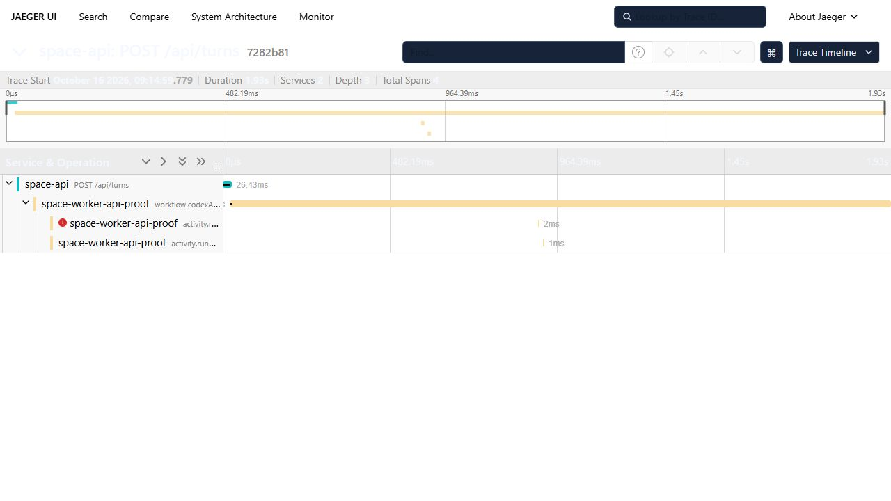

# SpaceApp worker tracing proof

Actual Jaeger capture from the `otlp-api-trace.integration.test.ts` test, run on 2026-10-16. This evidence branch is separate from the application change so the screenshot is not added to the source PR.

The test sends a real HTTP `POST /api/turns` request to the API, starts the production `codexAppServerTurnWorkflow` in a real Temporal test environment, and runs a stub activity that fails once and succeeds on its second attempt. The same OTLP payloads were received by a local Jaeger all-in-one collector. All room, pane and request IDs are synthetic test fixtures; no provider or operator instance was used.



Trace ID: `7282b812788d59aad12f61c8d2d271c3`.

| Span | ID | Parent |
| --- | --- | --- |
| API `POST /api/turns` | `7f5018c18a70f6c1` | root |
| `workflow.codexAppServerTurnWorkflow` | `ef5d99e41450eb48` | `7f5018c18a70f6c1` |
| `activity.runCodexAppServerTurn`, attempt 1, failed | `e43f8ce78a35c5ec` | `ef5d99e41450eb48` |
| `activity.runCodexAppServerTurn`, attempt 2, completed | `aa976df8e79a9ad6` | `ef5d99e41450eb48` |

[Original Jaeger response](jaeger-trace.json) provides the complete parent references and allowlisted attributes. The screenshot is an unedited browser capture. The first activity's error marker is the deliberate retry fixture.

Reproduce with a local OTLP/HTTP collector on port 4318:

```sh
SPACE_TEST_JAEGER_ENDPOINT=http://127.0.0.1:4318 npm test -w @space/worker -- otlp-api-trace.integration.test.ts
```

The optional mirror accepts only an unauthenticated loopback HTTP origin. The normal test uses its own loopback HTTP collector and does not require Jaeger.
